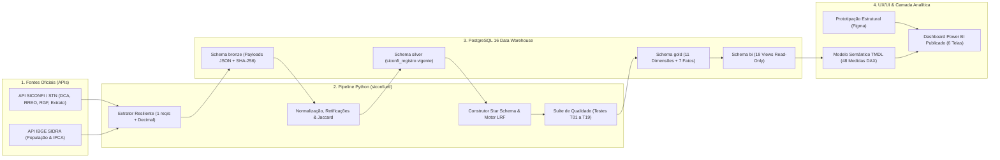
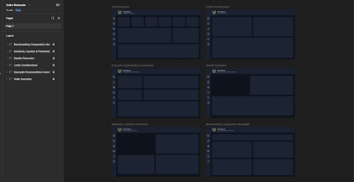
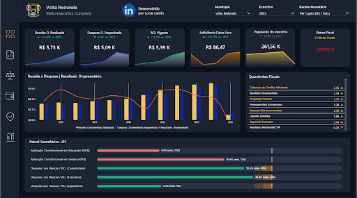
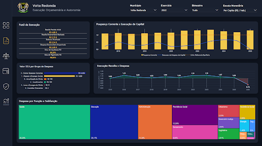
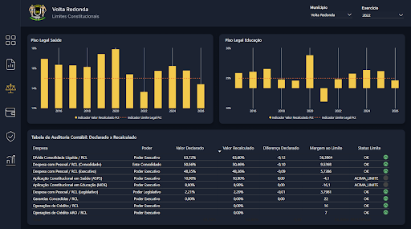
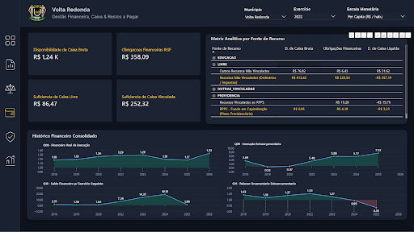
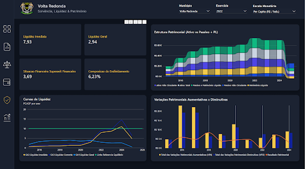
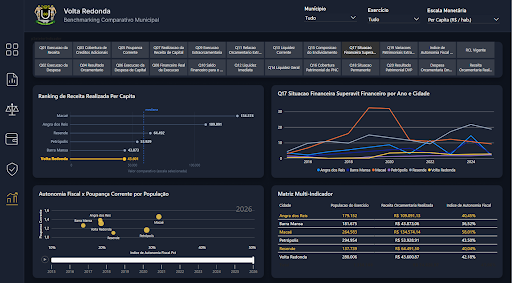

# Volta Redonda — Pipeline Medallion SICONFI & Painel de Gestão Fiscal, Orçamentária e Patrimonial


Plataforma *end-to-end* de **Engenharia de Dados Governamentais** e **Business Intelligence** desenvolvida para o monitoramento contínuo da saúde financeira, conformidade legal (**LRF e Constituição Federal**) e solvência patrimonial do município de **Volta Redonda - RJ (`3306305`)**, com *benchmarking* regional frente a **5 municípios-pares fluminenses** (**Barra Mansa**, **Resende**, **Angra dos Reis**, **Petrópolis** e **Macaé**) ao longo da série histórica **2015–2026**.

O sistema automatiza a extração de dados abertos oficiais da **Secretaria do Tesouro Nacional (SICONFI/STN)** e do **IBGE (SIDRA)**, processa mais de **1,06 milhão de registros** em arquitetura **Medallion (`bronze` → `silver` → `gold` → `bi`)** no PostgreSQL com bloqueio automático contra inconsistências contábeis, e abastece um modelo semântico tabular versionado em **TMDL** e publicado no **Power BI** com layout concebido no **Figma**.

> **Autoria:** Desenvolvido por **Lucas Lamin**  
> **Fundamentação Contábil:** Lei nº 4.320/1964, LC nº 101/2000 (LRF), MCASP/STN e matriz de 20 quocientes econômico-financeiros aplicados ao setor público (Kohama, 2015; Aguiar, 2025).

---

## 1. Arquitetura Ponta a Ponta


---

## 2. Design UX/UI (Figma) e Galeria do Painel Power BI

Toda a identidade visual, hierarquia de informação, navegação lateral e estrutura de cartões em *Dark Mode* foram **prototipadas previamente no Figma** antes da implementação no Power BI Desktop. Os *frames* estruturais exportados do Figma compõem as camadas de fundo em [`dashboard/Telas/`](dashboard/Telas/), sobre as quais foram construídos os visuais nativos e especificações Vega-Lite (**Deneb**).

### Prototipação e Arquitetura de Layouts no Figma
Mapeamento estrutural (*wireframe*) das 6 visões analíticas que compõem a experiência de navegação do painel:



---

### Telas do Painel Publicado no Power BI

[Painel Publicado](https://app.fabric.microsoft.com/view?r=eyJrIjoiMWVhYWYwMGUtMjI1ZS00NjcwLWFiZDYtZjE2MTQ0YjhjZGQ0IiwidCI6IjgxYTE3MGIwLTE3OWYtNDljNC1iZTkzLWUyZDg1YmM2YTkxYiJ9)

#### Módulo 1 — Visão Executiva Completa
Síntese rápida para tomada de decisão: 6 cartões de KPIs com *sparklines* evolutivas (Receita Orçamentária Realizada, Despesa Empenhada, RCL Vigente, Suficiência de Caixa Livre, População e Status Fiscal), série histórica *Receita × Despesa | Resultado Orçamentário*, painel resumido de *Quocientes Fiscais* e *Painel Semafórico LRF* (*Bullet Chart* comparando execução frente aos limites constitucionais e prudenciais).



#### Módulo 2 — Execução Orçamentária e Autonomia
Análise do Balanço Orçamentário (`DCA I-C/I-D` e `RREO 01/02`): *Funil da Execução* (da Previsão Inicial até o Grau de Pagamento), comparativo histórico *Poupança Corrente (`Q05`) × Execução de Capital (`Q06`)*, *Valor DCA por Grupo de Despesa*, curva de *Execução Receita × Despesa* e *Treemap* de distribuição da Despesa por Função e Subfunção (Saúde, Educação, Administração, Previdência Social, Saneamento).



#### Módulo 3 — Limites Constitucionais e Auditoria LRF
Monitoramento de conformidade legal (`fIndicador` + `dLimiteLRF`): séries históricas de cumprimento do **Piso Legal de Saúde (ASPS — mín. 15%)** e do **Piso Legal de Educação (MDE — mín. 25%)**, acompanhadas da **Tabela de Auditoria Contábil (Declarado × Recalculado)**, que confronta os percentuais declarados pelo município com o recálculo independente do Data Warehouse (DCL/RCL, Pessoal/RCL por Poder, ASPS, MDE, Garantias e Operações de Crédito).



#### Módulo 4 — Gestão Financeira, Caixa & Restos a Pagar
Regime de caixa puro (`DCA I-G` Balanço Financeiro e `RGF Anexo 05`): cartões de Disponibilidade de Caixa Bruta, Obrigações Financeiras RGF, Suficiência de Caixa Livre e Vinculada; *Matriz Analítica por Fonte de Recurso* (`LIVRE`, `EDUCACAO`, `SAUDE`, `PREVIDENCIA`, `OUTRAS_VINCULADAS`, harmonizando a transição nacional de fontes da STN) e *Histórico Financeiro Consolidado* (`Q08` a `Q11`).



#### Módulo 5 — Solvência, Liquidez & Patrimônio
Visão contábil patrimonial (`DCA I-AB` PCASP / Lei nº 4.320 e `DCA I-HI` DVP): indicadores de *Liquidez Imediata*, *Liquidez Geral*, *Situação Financeira (Superávit Financeiro)* e *Composição do Endividamento*; evolução da *Estrutura Patrimonial (Ativo vs. Passivo + PL)*; *Curvas de Liquidez PCASP (`Q12`, `Q13`, `Q14`)* e confronto entre *Variações Patrimoniais Aumentativas e Diminutivas (VPA × VPD)*.



#### Módulo 6 — Benchmarking Comparativo Municipal
Comparação padronizada entre **Volta Redonda**, **Angra dos Reis**, **Barra Mansa**, **Macaé**, **Petrópolis** e **Resende**: seletor interativo de **24 indicadores** (`Q01` a `Q20` e índices fiscais), *Ranking de Receita Realizada Per Capita*, evolução comparativa do *Superávit Financeiro (`Q17`) por Ano e Cidade*, dispersão *Autonomia Fiscal × Poupança Corrente ponderada por População* e *Matriz Multi-Indicador*.



---

## 3. Resumo da Implementação (Fases 0 a 7)

O projeto foi executado de forma incremental e auditada em **8 fases sequenciais**:

| Fase | Escopo Entregue | Principais Resultados e Métricas Auditadas |
|---|---|---|
| **Fase 0** | **Fundação & Infraestrutura DW** | PostgreSQL 16 isolado em Docker (`5433`), DDLs idempotentes (`bronze`, `silver`, `gold`, `bi`), role *read-only* `powerbi_ro` e tipagem 100% `NUMERIC` (zero `float`). |
| **Fase 1** | **Extração Resiliente & Camada Bronze** | Cliente HTTP com *throttling* estrito (`>= 1.10s`), paginação ORDS, cache incremental guiado por `/extrato_entregas` e *hash* `SHA-256`. **874 entregas SICONFI (`1.031.923` células brutas)**, **142 meses de IPCA** e séries populacionais IBGE. |
| **Fase 2** | **Camada Silver, Profiling & Seeds** | Normalização Unicode NFC, controle de retificações (`eh_vigente`), desambiguação por regex de contas repetidas (função/subfunção e fonte), análise de estabilidade longitudinal por **Índice de Jaccard** e curadoria de **8 seeds CSV** com zero colisões. |
| **Fase 3** | **Dimensões Gold (`gold.d_*`)** | Carga idempotente de **11 dimensões** (`d_calendario`: 5.113 dias; `d_conta`: 4.603 contas com separação estrita entre folhas `eh_folha=1` e sintéticas `eh_total=1`; `d_funcao`: 185; `d_natureza_despesa`: 142; `d_coluna`: 136; `d_fonte_recurso`: 50; `d_secao`: 43; `d_indicador`: 37; `d_limite_lrf`: 10; `d_ente`: 6; `d_poder`: 3). |
| **Fase 4** | **Fatos Gold (`gold.f_*`) & Motor LRF** | Carga transacional por partição (`DELETE + COPY` com `Decimal` exato) somando **> 1.062.000 linhas** (`f_rreo`: 857.064; `f_rgf`: 104.905; `f_dca`: 98.228; `f_indicador`: 2.153; `f_populacao`: 144; `f_ipca`: 142) e consolidação automática `Executivo + Legislativo` no RGF-01. |
| **Fase 5** | **Qualidade (`T01`–`T19`), Views `bi` & CLI** | Motor de auditoria contábil com **8 testes bloqueantes (*fail-fast* com *rollback*)** e **11 conciliações MCASP** gravadas em `gold.f_qualidade`, exposição de **19 views semânticas** no schema `bi` e **26/26 testes automatizados (`pytest`)** aprovados. |
| **Fase 6** | **Modelo Semântico Power BI (TMDL + DAX)** | Star Schema 1:N unidirecional em modo *Import*, versionado em **32 arquivos `.tmdl`**, *Calculation Group* `cgEscalaValor` (`Nominal`, `Real - IPCA` e `Per Capita` com parâmetro `pDataBaseIPCA`) e biblioteca com **48 medidas DAX** auditadas. |
| **Fase 7** | **UX/UI (Figma), Dashboard & Publicação** | Prototipação das telas no Figma, construção dos visuais nativos e Vega-Lite (Deneb) no Power BI Desktop, homologação cruzada com relatórios oficiais da STN e publicação do painel final. |

---

## 4. Decisões Críticas de Engenharia e Governança Contábil

- **Precisão Decimal Absoluta (`Zero Float`):** O *parse* dos payloads JSON da STN utiliza exclusivamente `parse_float=decimal.Decimal`, mantendo precisão exata até colunas `NUMERIC(18,2)` no PostgreSQL e `Fixed Decimal Number` no Power BI — eliminando desvios de ponto flutuante binário IEEE 754.
- **Preservação Semântica `NULL ≠ 0`:** Períodos não entregues ou demonstrativos com exigibilidade apenas no encerramento anual (ex.: `RGF Anexo 05` em quadrimestres intermediários de municípios com regime facultativo) permanecem `NULL` / `BLANK()`, jamais contaminando séries históricas com zeros artificiais.
- **Prevenção de Dupla Contagem e Semiaditividade:** O motor de plano de contas impede que contas sintéticas (`eh_total = 1`) sejam marcadas como analíticas (`eh_folha = 1`). Saldos patrimoniais, RCL e estoques do RGF são avaliados em DAX com semântica semiaditiva (`LASTDATE`).
- **Modificadores Monetários Transversais (`cgEscalaValor`):** Qualquer medida monetária do relatório pode ser inspecionada dinamicamente em **Reais Nominais**, **Reais Constantes (deflacionados pelo IPCA até a data-base selecionada)** ou **Reais Per Capita (`R$ / hab.`)** para comparabilidade intertemporal e intermunicipal justa.
- **Fail-Fast contra Mudanças Silenciosas de Leiaute:** Caso um novo exercício da STN introduza coluna (`T02`), seção (`T15`) ou fonte (`T17`) não mapeada nos arquivos `seeds/`, o pipeline aborta a publicação no Gold com `ROLLBACK` imediato antes de expor dados incompletos ao BI.

---

## 5. Matriz Resumida de Indicadores Monitorados

1. **Limites Constitucionais e LRF (`gold.f_indicador` — 10 Indicadores Materializados):**
   - **Despesa com Pessoal / RCL:** Poder Executivo (máx. `54%`), Poder Legislativo (máx. `6%`) e Consolidado Municipal (máx. `60%`), com faixas de Alerta (`90%`) e Prudencial (`95%`).
   - **Endividamento e Crédito (`RGF 02, 03, 04`):** Dívida Consolidada Líquida / RCL (máx. `120%`), Garantias Concedidas / RCL (máx. `22%`), Operações de Crédito / RCL (máx. `16%`) e ARO / RCL (máx. `7%`).
   - **Mínimos Constitucionais (`RREO 08, 12`) e Caixa (`RGF 05`):** Manutenção e Desenvolvimento do Ensino — MDE (mín. `25%`), Ações e Serviços Públicos de Saúde — ASPS (mín. `15%`) e Suficiência de Caixa Líquida Livre.
2. **Quocientes Econômico-Financeiros (`Q01` a `Q20` — Kohama / MCASP em DAX):**
   - **Balanço Orçamentário (`Q01`–`Q07`):** Execução da Receita, Equilíbrio Orçamentário, Cobertura de Créditos Adicionais (com proteção de materialidade para denominadores residuais), Execução da Despesa, Poupança Corrente, Execução de Capital e Resultado Orçamentário.
   - **Balanço Financeiro (`Q08`–`Q11`):** Financeiro Real da Execução Orçamentária, Execução Extraorçamentária, Resultado da Execução Financeira e Efeito Cascata de Saldos Financeiros.
   - **Balanço Patrimonial e DVP (`Q12`–`Q20`):** Liquidez Imediata, Liquidez Corrente, Liquidez Geral, Composição do Endividamento, Resultado Patrimonial, Situação Financeira (`Lei 4.320/64`), Situação Permanente, Ganhos/Perdas de Ativos e Resultado das Variações Patrimoniais (`VPA ÷ VPD`).
3. **Indicadores de Gestão e Autonomia:** Índice de Autonomia Fiscal, Dependência de Transferências, Grau de Liquidação, Grau de Pagamento e Suficiência de Caixa aberta por Fonte de Recurso.

---

## 6. Estrutura do Repositório

```text
volta_redonda/
├── dashboard/
│   ├── Volta_Redonda.pbix                                       # Relatório Power BI Desktop completo
│   ├── Documentação Visual — Painel Fiscal Volta Redonda.pdf    # Caderno visual (Figma + 6 Telas)
│   ├── Telas/                                                   # Backgrounds exportados do Figma
│   └── prints/                                                  # Capturas das telas publicadas e wireframe
├── powerbi/
│   └── SaudeFiscalMunicipal.SemanticModel/                      # Modelo Semântico versionado em TMDL (32 arquivos)
├── src/
│   └── siconfi_etl/                                             # Pacote Python do Pipeline Medallion
│       ├── cli.py                                               # Interface de linha de comando (Typer + Rich)
│       ├── config.py                                            # Contratos de configuração (Pydantic Settings)
│       ├── db.py                                                # Conexão psycopg3 e carga transacional COPY
│       ├── pipeline.py                                          # Orquestrador ponta a ponta com etl_controle
│       ├── extract/                                             # Clientes SICONFI (1 req/s) e IBGE SIDRA
│       ├── silver/                                              # Normalizador, desambiguador, profiler e seeds
│       ├── gold/                                                # Construtores de dimensões, fatos e motor LRF
│       └── quality/                                             # Suíte de testes contábeis T01 a T19
├── sql/                                                         # Scripts DDL idempotentes (01 a 06)
├── seeds/                                                       # 8 catálogos CSV auditados (colunas, contas, LRF)
├── tests/                                                       # Suíte automatizada Pytest (Fases 0 a 5)
├── docs/                                                        # Especificações técnicas, profiling e referências
├── docker-compose.yml                                           # Container PostgreSQL 16 (porta 5433)
├── pyproject.toml                                               # Metadados do projeto e entrypoint CLI
├── siconfi.yaml                                                 # Especificação OpenAPI da STN/SICONFI
└── .env.example                                                 # Template de variáveis de ambiente
```

---

## 7. Como Executar Localmente

### Pré-requisitos
- **Docker** e **Docker Compose**
- **Python 3.11+**
- **Power BI Desktop** (para abrir o `.pbix` ou conectar à instância local)

### Passo a Passo

```powershell
# 1. Configurar variáveis de ambiente
Copy-Item .env.example .env
# Edite o arquivo .env definindo senhas seguras para POSTGRES_PASSWORD e POWERBI_RO_PASSWORD

# 2. Subir o banco de dados PostgreSQL 16 (mapeado na porta 5433)
docker compose up -d

# 3. Criar ambiente virtual e instalar o pacote e dependências de desenvolvimento
python -m venv .venv
.\.venv\Scripts\Activate.ps1
pip install -e ".[dev]"

# 4. Inicializar schemas, tabelas, views e permissões do Data Warehouse
siconfi-etl init-db

# 5. Executar o pipeline Medallion completo (Extração -> Silver -> Gold -> Qualidade)
siconfi-etl run-all
```

### Comandos Modulares da CLI (`siconfi-etl`)

```powershell
siconfi-etl status-db          # Inventário de tabelas e views por schema
siconfi-etl extract            # Fase 1: Extração incremental SICONFI + IBGE para Bronze
siconfi-etl build-silver       # Fase 2: Normalização, desambiguação e retificações na Silver
siconfi-etl profile            # Fase 2: Relatório de cobertura e estabilidade de Jaccard
siconfi-etl build-gold-dims    # Fase 3: Construção idempotente das 11 dimensões Gold
siconfi-etl build-gold-facts   # Fase 4: Carga transacional dos fatos e indicadores LRF
siconfi-etl quality-check      # Fase 5: Execução isolada da suíte contábil (T01 a T19)
pytest                         # Executa os 26 testes automatizados de unidade e integração
```